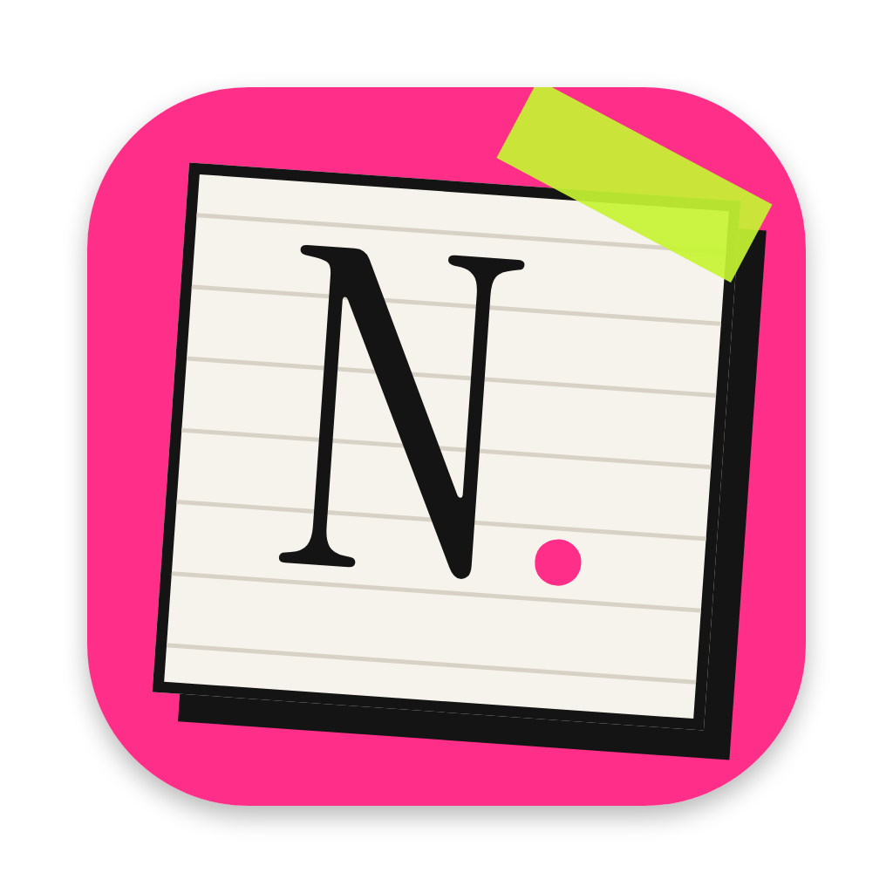
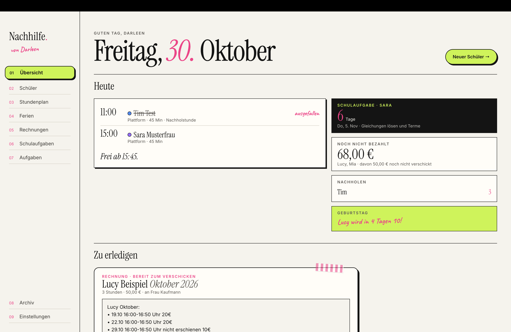
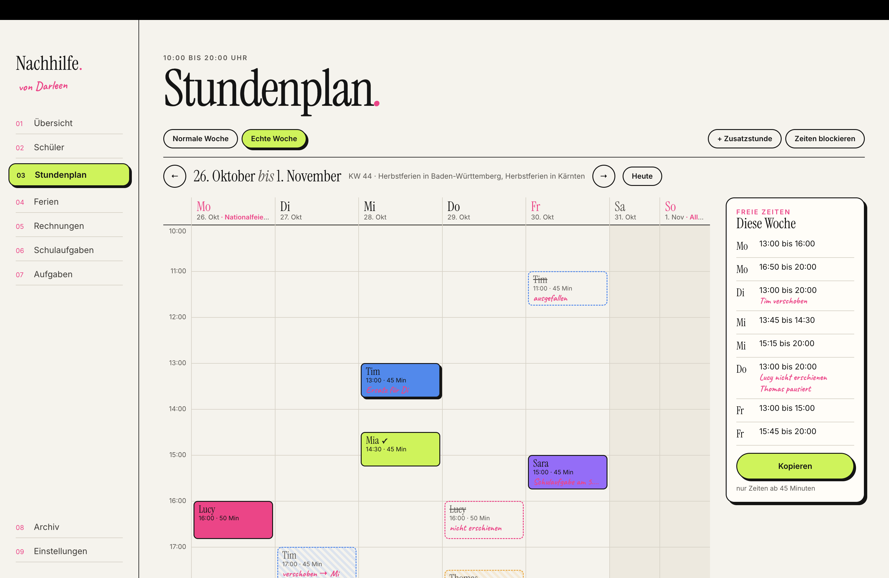
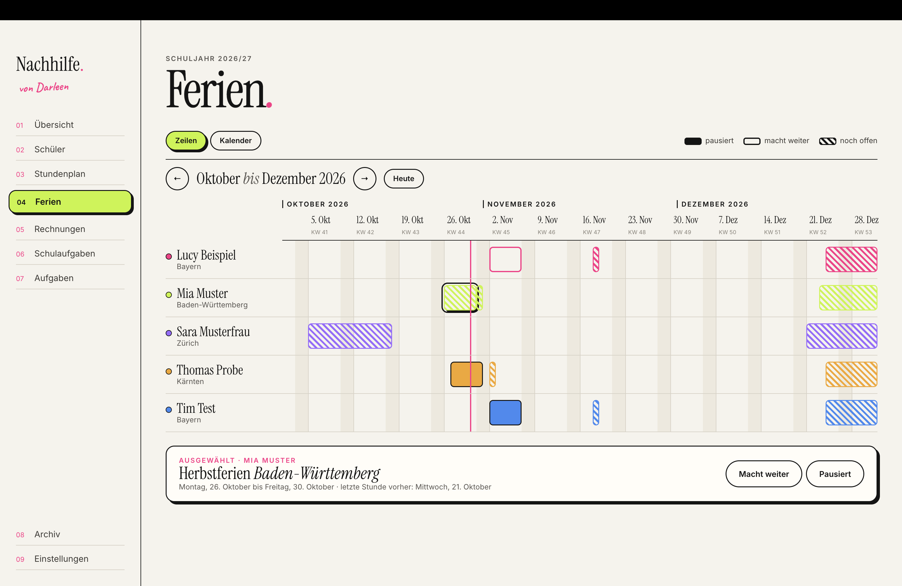
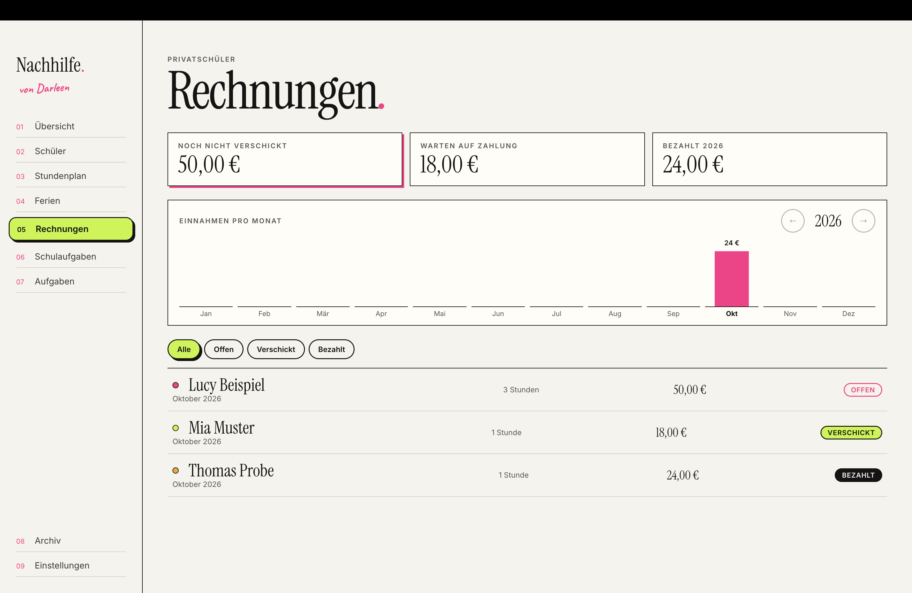

<p align="center">
  
</p>

<h1 align="center">Nachhilfe-Planer</h1>

<p align="center">
  Eine Mac-App, mit der ich meine Mathe-Nachhilfe organisiere:<br>
  Schüler, Stundenplan, Ferien, Rechnungen, Schulaufgaben und Übungsmaterial an einem Ort.
</p>

<p align="center">
  
</p>

## Warum diese App?

Ich gebe Mathe-Nachhilfe, teils privat und teils über eine Plattform, für Schüler aus Deutschland, Österreich und der Schweiz. Vorher waren Termine, Ferien, Nachholstunden und Rechnungen über Kalender, Notizen und WhatsApp verteilt. Der Nachhilfe-Planer bündelt alles in einer App, die unauffällig in der Menüleiste läuft und mir jeden Tag zeigt, was ansteht.

## Funktionen

**Übersicht**
- Die heutigen Stunden mit Status und dem Hinweis, ab wann ich frei bin
- Kacheln für offene Beträge, Nachholstunden, die nächste Schulaufgabe und Geburtstage
- Eine Liste mit allem, was zu erledigen ist: Stunden bestätigen, Rechnungen verschicken, Ferien klären

**Menüleiste**
- 📚 mit der Zahl offener Aufgaben
- Ein kleines Fenster mit dem Tag auf einen Blick

**Schüler**
- Übersichtliche Schülerseite mit Steckbrief, Regelmäßigkeit, Schulaufgaben und Stunden
- Privat- und Plattformschüler mit Land, Bundesland bzw. Kanton, Schulform, Klasse und festen Terminen
- Regelmäßigkeit pro Schüler mit und ohne Ferien als Punktreihe
- Nachholstunden für Plattformschüler, die sich automatisch aus Ausfällen und nachgeholten Stunden berechnen
- Archiv für ehemalige Schüler

**Stundenplan**
- Normale Woche und echte Woche mit Ferien, Verschiebungen, Ausfällen und Zusatzstunden
- Blockierte Zeiten per Ziehen mit der Maus
- Freie Zeiten auf einen Klick zum Kopieren

**Ferien und Feiertage**
- Schulferien und Feiertage für alle Bundesländer und Kantone in DE, AT und CH über die [OpenHolidays API](https://www.openholidaysapi.org)
- Zeitleiste über drei Monate und Jahreskalender mit einer Linie pro Region
- Pro Schüler und Ferien: macht weiter oder pausiert
- Feiertage auch im Stundenplan markiert

**Rechnungen**
- Monatsrechnung als fertiger Text für WhatsApp, bearbeitbar und kopierbar
- Status offen, verschickt und bezahlt mit Summen
- Einnahmen pro Monat und Jahr

**Schulaufgaben**
- Termine mit Countdown, Themen, Notizen, angehängten Dateien und Noten im jeweiligen Notensystem
- Hinweis im Stundenplan bei der letzten Stunde vor der Arbeit

**Aufgaben**
- Sammlung von Links und Dateien mit frei wählbaren Themen und Klassenstufen
- Suche und Filter nach Klasse und Thema

**Sonstiges**
- Automatische tägliche Sicherung, zum Beispiel in iCloud Drive
- Eigene Dialoge im Stil der App
- Zwei Akzentfarben frei wählbar
- Plattformschüler lassen sich ausschalten, wenn man nur privat unterrichtet
- Funktioniert komplett offline, nur die Ferien werden aus dem Internet geladen

## Screenshots

| Stundenplan | Ferien |
| --- | --- |
|  |  |

| Rechnungen | Menüleiste |
| --- | --- |
|  |  |

## Technik

- **[Electron](https://www.electronjs.org)** mit Hauptprozess, Preload-Skript und Renderer
- **HTML, CSS und JavaScript** ohne Framework
- **Daten** als JSON-Datei im Benutzerordner der App, sicher geschrieben über eine temporäre Datei
- **Schriften** Instrument Serif, Inter und Caveat über [Fontsource](https://fontsource.org), damit alles offline funktioniert
- **Verpackung** mit [@electron/packager](https://github.com/electron/packager)

### Aufbau

| Datei | Aufgabe |
| --- | --- |
| `main.js` | Fenster, Menüleiste, Speichern, Ferien-API, Sicherung, Dateien |
| `preload.js` | Sichere Schnittstelle zwischen App und Hauptprozess |
| `main.html` | Alle Seiten der App |
| `renderer.js` | Logik und Darstellung der Seiten |
| `popover.html` | Kleines Fenster in der Menüleiste |
| `laender.js` | Bundesländer, Kantone, Schulformen und Noten für DE, AT und CH |
| `style.css` | Gestaltung |

## Herunterladen

Die fertige App für Macs mit Apple-Chip gibt es unter [Releases](https://github.com/darleenfritz/nachhilfe-planer/releases). ZIP entpacken und `Nachhilfe.app` in den Programme-Ordner ziehen.

Die App ist nicht von Apple signiert. Beim ersten Öffnen deshalb mit **Rechtsklick auf die App › Öffnen** starten und die Nachfrage bestätigen. Falls macOS das Öffnen trotzdem verhindert: **Systemeinstellungen › Datenschutz & Sicherheit › Trotzdem öffnen**.

## Selbst starten

Voraussetzung ist [Node.js](https://nodejs.org).

```bash
git clone https://github.com/darleenfritz/nachhilfe-planer.git
cd nachhilfe-planer
npm install
npm start
```

## Als Mac-Programm verpacken

```bash
npm run package
```

Die fertige App liegt danach in `dist/Nachhilfe-darwin-arm64/Nachhilfe.app` und kann in den Programme-Ordner gezogen werden.

## Datenschutz

Alle Daten bleiben lokal auf dem Mac. Die App sendet nur die Kürzel der Bundesländer bzw. Kantone an die OpenHolidays API, um die Schulferien zu laden. Es gibt keine Konten, keine Cloud und keine Analyse.

## Design

Die Gestaltung verbindet einen ruhigen, redaktionellen Stil mit Cremetönen, Haarlinien und einer Serifenschrift mit verspielten Akzenten: Washi-Tape, Handschrift und harte Schatten in Pink und Limette.

## Lizenz

[MIT](LICENSE): Du darfst den Code frei verwenden, verändern und weitergeben, solange der Lizenzhinweis erhalten bleibt.
